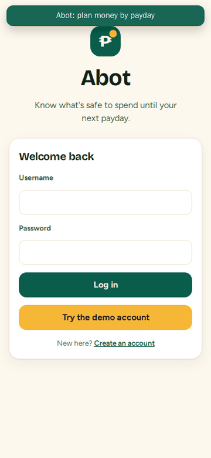

# Abot

**Know what's safe to spend until your next payday.** *Abot* is Filipino for "reach", as in *aabot ba hanggang sahod?* (will the money last until payday?)

<p align="center"></p>

A money app built around paydays. Most budget apps plan by the month. Many Filipinos are paid
twice a month (*kinsenas*: the 15th and 30th), and the money runs out *between paydays*. Abot
answers one question on its home screen: how much you can spend **today** without coming up short
before sahod.

Portfolio project. Django REST API + React/TypeScript, PostgreSQL, Docker, GitHub Actions. Free
to build and run. **All demo data is fake** (Faker).

## What it does

| | |
|---|---|
| **Safe to spend today** | Spendable wallets − unpaid bills due before the next payday − your buffer, spread over the days left. Today's budget is fixed in the morning, so spending lowers "left today", not tomorrow's math. Status turns *tight*, *over* or *short* with a plain-language hint. |
| **Paydays that match real life** | Twice a month, monthly or weekly. A "30th" payday is Feb 28 in February. Weekend paydays move to the Friday before (or Monday after), like most payrolls. |
| **Payday split** | When salary lands, rules move it in one step: 15% to Savings, ₱2,500 padala to family, ₱4,000 to GCash. These planned moves don't count as "spent today". |
| **Quick add** | Type `kape 150 gcash`, `jeep 13 kahapon`, `+25k sahod bank` or `500 gcash to cash`. Amount, wallet, category, type and date are filled in as you type. It learns your words: file "siomai" under Food & drinks once and it knows next time. |
| **Wallets** | GCash, Maya, cash, bank, savings. Balances are computed from the ledger, never stored, so they can't drift. Transfers between wallets. |
| **Bills** | Monthly bills (Meralco, rent, internet) are set aside until paid; one tap marks a due date paid. |
| **Utang** | Who owes you and whom you owe, with partial payments. Lending moves your wallet balance but is never "spending"; utang you owe that's due before payday is set aside like a bill. |
| **Paluwagan** | Rotating savings groups whose rounds can follow *your* paydays. A timeline shows paid, late and your turn; shares due before payday are set aside; your pot shows when it lands. |
| **Ipon goals** | "₱20,000 for Siargao by March": Abot counts the paydays left and tells you how much to set aside **each sahod**. |
| **Cycle report** | This pay cycle next to the last one: received, spent, kept, your pace at the same point, category changes, biggest purchases. Export everything to CSV (spreadsheet-safe). |
| **Installable** | A PWA: add it to your phone's home screen. API data is never cached. |

## Quickstart

Needs [Docker Desktop](https://www.docker.com/products/docker-desktop/).

```bash
cp .env.example .env            # Windows cmd: copy .env.example .env
docker compose up --build       # Postgres, Django API (:8001), React dev server (:5173)
docker compose run --rm api python manage.py seed_demo
```

Open <http://localhost:5173> and log in as **demo** / **abot-demo**, or create an account.

Production-style (built React served by Django + gunicorn, DEBUG off) on <http://localhost:8081>:

```bash
docker compose -f docker-compose.prod.yml -p abot-prod up --build -d
```

## Tests and checks

```bash
docker compose run --rm api pytest                  # backend: rules, API, isolation, auth
docker compose run --rm api ruff check .
docker compose run --rm frontend npm test           # Vitest: money math, quick-add parser
docker compose run --rm frontend npm run lint       # ESLint + TypeScript
```

CI (GitHub Actions) runs all of these, plus `manage.py check --deploy` in HTTPS mode, a
dependency audit (pip-audit, npm audit), and a production Docker build.

## Design decisions

- **Pay-cycle math as pure functions** ([planning/cycle.py](planning/cycle.py)). Paydays,
  short months, weekend rules and safe-to-spend have no database code, so every rule has a fast,
  direct unit test. The API only gathers the inputs.
- **Money is never a float.** `Decimal` in Python; integer centavos in TypeScript, converted from
  the API's decimal strings at the edge.
- **Balances are derived, not stored.** Opening balance + the ledger. There's no running total
  to get out of sync after an edit or delete.
- **One container, same origin.** Django serves the built React app, so auth is plain session
  cookies + CSRF. There are no tokens in localStorage, no CORS, and nothing extra to configure.
  In development Vite proxies `/api`, so the browser sees the same single origin.
- **Users can't see each other's data, by construction.** Every query is scoped to the owner.
  Another user's id returns 404 (not 403, so ids can't be probed), and related ids in a request
  body (wallet, category) only resolve among your own rows. Tests check this per endpoint.
- **Strict security headers.** CSP `script-src 'self'` (no inline scripts), HttpOnly session
  and CSRF cookies, CSRF enforced on login too (DRF skips it for anonymous users by default), login
  and sign-up throttled with counters in Postgres (stateless web container), `no-store` on
  API responses, a test that every API URL needs a signed-in user.
- **Neutral money moves.** Lending, repaying and paluwagan shares change wallet balances (so
  safe-to-spend is right) but are flagged neutral, so spending and income reports never count
  them. Only the module that created them can change them.
- **No router or state library.** Five screens; a 30-line router and a small context are enough.
  Fewer dependencies, less to audit.

## Project layout

```
config/      settings (all from env), URLs, health + React shell views
core/        base models, security headers, shared API helpers
accounts/    custom user, auth API (csrf, signup, login, logout, me)
money/       wallets, categories, transactions, seed_demo
planning/    pay schedule, bills, payday split, cycle math, Today summary
utang/       lending and borrowing with partial payments
paluwagan/   rotating savings groups
frontend/    React + TypeScript app (Vite), PWA service worker, Vitest tests
```

## Status

- [x] Wallets, transactions, transfers, quick add
- [x] Pay schedule, bills, safe to spend today, payday split
- [x] Installable PWA, demo data, CI
- [x] Utang (who owes whom, partial payments)
- [x] Paluwagan (rotating savings groups on your paydays)
- [ ] Live demo (Render + Neon, free): ready to deploy, see [docs/deploy.md](docs/deploy.md)

Security controls and how they're tested: [SECURITY.md](SECURITY.md).
